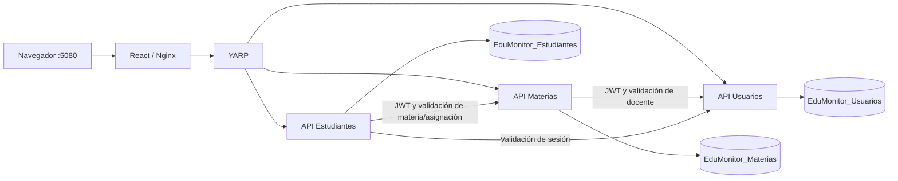

# EduMonitor AI — Sprint 1

Plataforma académica local con React + TypeScript, tres APIs independientes ASP.NET Core 10, Gateway YARP, Entity Framework Core y SQL Server. Interfaz en español. No utiliza Moodle, IA generativa ni servicios externos de IA.

## Inicio rápido en este equipo

1. Abre Docker Desktop y espera a que el motor esté listo.
2. Ejecuta **Iniciar EduMonitor.cmd** dentro de esta carpeta.
3. Espera el mensaje **EduMonitor está listo**. La primera construcción puede tardar varios minutos.
4. Abre **http://127.0.0.1:5080** en tu navegador.
5. Ejecuta **Ver acceso.cmd** desde el Explorador de Windows, o abre `.local/ACCESO.txt` en VS Code. Ahí están el correo y la contraseña del administrador.

En VS Code, hacer clic en un `.cmd` muestra su código; para ejecutarlo usa el Explorador o una terminal. Puedes abrir `EduMonitorAI.sln` en Visual Studio compatible con .NET 10.

**Todo se ejecuta ahora en Docker**, incluida la interfaz. No hace falta iniciar una API aparte ni instalar SQL Server Express. `Detener EduMonitor.cmd` detiene los contenedores del proyecto y conserva los datos.

## Arquitectura



Cada servicio tiene su propio proceso, proyecto, imagen Docker, DbContext, migraciones y base de datos. Una sola instancia SQL Server aloja las tres bases. Cada API se conecta con un login SQL distinto, limitado a su base. `database-init` crea las bases y permisos con `sa` y termina; no es un cuarto servicio de negocio. Los permisos `db_owner` de cada servicio permiten aplicar sus migraciones locales; en un despliegue productivo se separarían las credenciales de migración de las de ejecución.

No hay claves foráneas entre bases, consultas a tablas ajenas desde las APIs ni copias completas de entidades externas. `TeacherId` y `MateriaId` son referencias validadas mediante REST. El código compartido en `shared` contiene autenticación, errores y cliente HTTP; no contiene entidades ni lógica académica.

## Alcance de las historias

| Historia | Implementación |
|---|---|
| HU-01 | Login, validaciones, hash de contraseñas, JWT, roles, cierre de sesión, restricciones en backend |
| HU-02 | Registro, listado, consulta y edición de docentes; cuenta de acceso; correo único |
| HU-03 | Materias con código, nombre y período académico; edición; asignación/reasignación a un docente; código único |
| HU-04 | Estudiantes con código, nombres y apellidos; edición; matrícula; prevención de duplicados; lista por materia autorizada |

La materia puede registrarse sin docente y asignarse después. Solo puede tener un responsable. El estudiante no tiene cuenta de acceso y no necesita correo. No se exige especialidad al docente. No hay acciones de eliminación, retiro de matrículas, calificaciones, asistencia ni funcionalidades de los Sprints 2 y 3.

Los paneles muestran datos reales. Cada módulo consulta su propio endpoint: una caída de Estudiantes no bloquea la carga de Materias o Docentes.

## Presentación del flujo completo

1. Inicia sesión como administrador.
2. En **Docentes**, registra nombre, correo y contraseña de al menos 10 caracteres.
3. En **Materias**, registra código, nombre y período académico. Elige un docente o selecciona **Asignar después**.
4. Para asignar o cambiar el docente, usa **Editar / asignar** en la materia.
5. En **Estudiantes**, registra código, nombres y apellidos.
6. En **Materias → Ver estudiantes**, selecciona al estudiante y pulsa **Matricular**.
7. Cierra sesión e ingresa con el correo y contraseña del docente. Solo tendrá Resumen y Materias, con acceso a sus materias y estudiantes.
8. La restricción también se aplica a peticiones directas a las APIs. Las pruebas incluyen acceso ajeno y operaciones administrativas prohibidas.

El JWT vive en memoria del navegador y vence en una hora. Al recargar la página debes iniciar sesión otra vez. Cerrar sesión o cambiar una contraseña invalida los tokens anteriores. Cada API valida la firma; Materias y Estudiantes consultan además a Usuarios para confirmar que la sesión sigue vigente. Por eso **Usuarios es una dependencia necesaria para las operaciones autenticadas**: si cae, se responde de forma controlada y se deniega la operación. No se promete independencia frente a todas las posibles caídas.

## Demostrar la caída y recuperación de Estudiantes

Desde una terminal abierta en esta carpeta, con el sistema ya iniciado:

```powershell
docker compose stop estudiantes
```

Vuelve al navegador:

- Puedes iniciar sesión y consultar Docentes y Materias.
- Estudiantes y las matrículas muestran un error con **Reintentar**.
- El Gateway devuelve HTTP 503 para las peticiones a Estudiantes.
- Ninguna pantalla queda cargando indefinidamente: el cliente tiene un límite de 14 segundos.

Recupera únicamente ese servicio:

```powershell
docker compose start estudiantes
docker compose ps
```

Espera que aparezca `healthy`, pulsa **Reintentar** o **Actualizar** y comprueba que los registros anteriores siguen disponibles. No hay que reiniciar SQL Server, el frontend ni los demás servicios.

También se puede usar:

```powershell
powershell -ExecutionPolicy Bypass -File scripts/Demo-Fallo.ps1 -Action stop
powershell -ExecutionPolicy Bypass -File scripts/Demo-Fallo.ps1 -Action start
```

### Qué mecanismos existen

- Health checks de cada API y del Gateway; comprobación de SQL en las APIs; comprobación HTTP en Nginx.
- Manejo centralizado de excepciones, errores JSON y logs con identificador de solicitud.
- Timeout de 3 segundos por llamada interna, máximo dos intentos para **GET** con una pausa de 150 ms.
- No hay reintentos automáticos de POST o PUT, para evitar duplicar escrituras.
- YARP limita la inactividad de la petición a 10 segundos; Nginx limita la espera a 12 segundos.
- `restart: unless-stopped` reinicia contenedores que terminan inesperadamente. **Un `docker compose stop` es una parada voluntaria y requiere `start`.**
- Un estado `unhealthy` por sí solo no reinicia un contenedor en Docker Compose. No hay un sistema de autoreparación por health check ni circuit breakers avanzados.
- Si Materias cae, Estudiantes puede listar sus registros, pero rechaza matrículas y consultas por materia con 503: no guarda relaciones ni autoriza listas sin validar.

### Fallo inesperado del proceso (demostración opcional)

Este comando envía SIGTERM al proceso de Estudiantes desde dentro de su contenedor. La aplicación termina y Docker la reinicia; es una terminación controlada para demostrar la política, no una simulación de corrupción ni de corte eléctrico. No equivale a detenerlo manualmente con Compose:

```powershell
docker compose exec -T estudiantes sh -c 'kill -TERM 1'
docker compose ps
```

La política de reinicio debe volver a iniciarlo. Espera `healthy`. Para inspeccionar el contador:

```powershell
docker inspect edumonitorai-estudiantes-1 --format '{{.RestartCount}}'
```

## Pruebas

Con los contenedores levantados y el SDK .NET 10 disponible:

```powershell
powershell -ExecutionPolicy Bypass -File scripts/Test.ps1
```

La suite usa HTTP real a través de Nginx y YARP, los tres microservicios y SQL Server real. No usa mocks ni EF InMemory. Comprueba las cuatro historias, la comunicación entre servicios, la caída/recuperación de Estudiantes y el rechazo de matrículas si Materias está caído. Las pruebas de disponibilidad detienen servicios brevemente: no las ejecutes mientras otra persona está usando la demostración.

Cada prueba crea registros con un prefijo aleatorio propio y los elimina mediante una conexión SQL de pruebas al terminar; no elimina datos del usuario. Si se interrumpe la suite por fuerza pueden quedar registros identificados como pruebas. No existe endpoint público de borrado.

Para ejecutar solo las historias, sin detener contenedores:

```powershell
powershell -ExecutionPolicy Bypass -File scripts/Test.ps1 -OnlyFunctional
```

El reporte nuevo es `TestResults/microservices.trx`. El reporte antiguo `integration.trx` pertenece a la versión monolítica y no verifica esta arquitectura.

## Comandos de Docker y migraciones

`Start.ps1` genera secretos locales y un `.env` ignorado por Git. Una vez generado:

```powershell
docker compose build
docker compose up -d --wait --wait-timeout 180
docker compose ps
docker compose logs --tail 80 usuarios materias estudiantes gateway
docker compose stop
```

Los servicios usan `Database__Initialize=true` en el entorno local de Compose y aplican sus migraciones EF Core al arrancar. La opción predeterminada en `appsettings.json` es `false`; no se deben aplicar migraciones automáticamente en producción sin una estrategia de despliegue. El administrador se crea solo si no existe.

No ejecutes `docker compose down -v`: elimina el volumen que conserva las bases. `stop` no borra datos.

## Puertos y configuración

| Componente | Acceso |
|---|---|
| Aplicación completa | http://127.0.0.1:5080 |
| SQL Server desde VS Code / SSMS | `127.0.0.1,14333` |
| Gateway y APIs | Puerto 8080 interno; no publicados en el equipo |

Las bases se llaman `EduMonitor_Usuarios`, `EduMonitor_Materias` y `EduMonitor_Estudiantes`. Las contraseñas están en `.local/settings.json`: `UsuariosPassword`, `MateriasPassword`, `EstudiantesPassword`. Los usuarios SQL son `edumonitor_usuarios`, `edumonitor_materias` y `edumonitor_estudiantes`. `SqlPassword` corresponde al administrador SQL `sa`, usado para inicialización y pruebas. Todo esto es configuración local de desarrollo, no para exponer a Internet.

La comunicación interna utiliza los nombres `usuarios`, `materias`, `estudiantes`, `gateway` y `sqlserver`. Las solicitudes internas reenvían el JWT original, de modo que el servicio receptor comprueba la identidad y los permisos. No se utiliza un indicador de rol enviado libremente por React.

## Estructura y desarrollo

```text
frontend/                         React, TypeScript, Nginx y Dockerfile
services/usuarios/                API, servicios de negocio, modelos, DTO, DbContext y migraciones
services/materias/                API independiente de materias
services/estudiantes/             API independiente de estudiantes y matrículas
gateway/                          API Gateway YARP
shared/EduMonitor.Infrastructure/  Autenticación, errores y cliente HTTP
database/                         Creación de bases/permisos e importación del admin anterior
tests/EduMonitor.IntegrationTests/ Pruebas contra el despliegue real
scripts/                          Inicio, parada, pruebas y demostración de fallos
compose.yaml                      Despliegue local
backend/                          Versión anterior, fuera de la solución y del despliegue
```

Para compilar en el equipo:

```powershell
. ./scripts/Common.ps1
& $Dotnet build EduMonitorAI.sln
npm --prefix frontend ci
npm --prefix frontend run build
```

Para desarrollar React con recarga automática, mantén Compose activo y ejecuta `npm --prefix frontend run dev`. Abre `http://127.0.0.1:5173`; Vite envía `/api` al despliegue en 5080.

Los proyectos backend pueden ejecutarse por separado al configurar `ConnectionStrings__Default`, `Jwt__Key` y `Services__Usuarios`/`Services__Materias` para sus destinos. `gateway/appsettings.Development.json` usa los puertos locales 5101, 5102 y 5103. Docker utiliza la configuración Production con nombres internos; no es necesario configurar estos puertos para el uso habitual.

## Compartir con el equipo

Comparte los fuentes, Dockerfiles, `compose.yaml`, las migraciones, los tests, el lockfile npm y este README. No compartas `.env` ni `.local` (contienen contraseñas y el respaldo de la base). `.gitignore` excluye esos archivos, SDK, dependencias, compilados y resultados de prueba.

En otra computadora basta Docker Desktop con contenedores Linux y PowerShell para ejecutar el lanzador. Docker construye React y las APIs, por lo que no hace falta instalar SQL Server Express, Node ni .NET para usar la aplicación. Para editar y ejecutar las pruebas en el host sí se necesita .NET SDK 10; para desarrollar React localmente, Node compatible con Vite 7. El SDK local de este equipo no se comparte en Git.

Cada instalación genera sus propias credenciales. El `.env` se genera antes de invocar Compose; no incluye contraseñas universales de demostración. No se debe borrar `.local/settings.json` mientras se conserva un volumen SQL inicializado, porque se perdería la correspondencia con las contraseñas de las bases.

## Conservación de la versión anterior

La carpeta original es la misma. Se reutilizaron el diseño, validaciones, autenticación y flujos correctos. `backend/` conserva los fuentes anteriores como referencia; no participa en la solución actual. La base `EduMonitorAI` permanece intacta. Antes del cambio se comprobó que solo contenía el administrador y ningún registro académico; se respaldó en `.local/edumonitor-pre-microservices.bak` y se conservó su cuenta en Usuarios.

El importador comprueba esa condición y se detiene si encuentra datos académicos antiguos, para no inventar períodos o separar nombres automáticamente. No borra la base original. La copia de código previa está en `.local/pre-microservices`.

## Continuación del proyecto

Sprint 2 podrá ampliar Materias con unidades, temas y actividades y añadir calificaciones y seguimiento mediante referencias a estudiantes. Sprint 3 podrá incorporar un servicio C# de recomendaciones deterministas. Esas historias no se implementan ni se simulan en este sprint.


## Documentos de apoyo

- [Guion de presentación](docs/PRESENTACION.md).
- [Contratos de la API](docs/API.md).
- [Verificación realizada](VERIFICACION.md).

Los datos de demostración creados desde el navegador se conservan: docente de demostración, materia CV-001 y estudiante EST-001 matriculado. Su acceso docente está en .local/DEMO.txt; no lo compartas con los fuentes.


