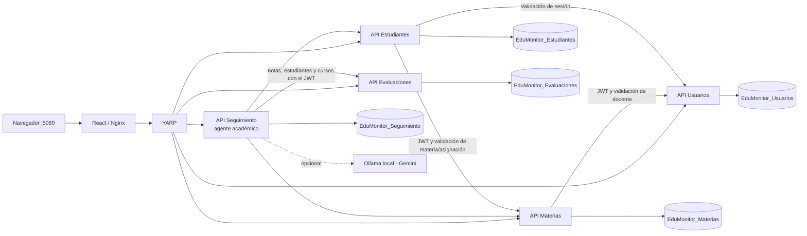

# EduMonitor AI — Sprints 1, 2 y 3

Plataforma académica local con React + TypeScript, cinco APIs independientes ASP.NET Core 10, Gateway YARP, Entity Framework Core y SQL Server. Interfaz en español. Se integra con Moodle (lectura de matrícula y notas) y su agente académico usa IA local (Ollama) o en la nube (Gemini), con plantillas de respaldo si ninguna está disponible.

## Inicio rápido en este equipo

¿Vas a instalar todo en otra computadora (EduMonitor + Moodle + IA)? Sigue la guía completa: [docs/INSTALACION.md](docs/INSTALACION.md).

1. Abre Docker Desktop y espera a que el motor esté listo.
2. Ejecuta **Iniciar EduMonitor.cmd** dentro de esta carpeta.
3. Espera el mensaje **EduMonitor está listo**. La primera construcción puede tardar varios minutos.
4. Abre **http://127.0.0.1:5080** en tu navegador.
5. Ejecuta **Ver acceso.cmd** desde el Explorador de Windows, o abre `.local/ACCESO.txt` en VS Code. Ahí están el correo y la contraseña del administrador.

En VS Code, hacer clic en un `.cmd` muestra su código; para ejecutarlo usa el Explorador o una terminal. Puedes abrir `EduMonitorAI.sln` en Visual Studio compatible con .NET 10.

**Todo se ejecuta ahora en Docker**, incluida la interfaz. No hace falta iniciar una API aparte ni instalar SQL Server Express. `Detener EduMonitor.cmd` detiene los contenedores del proyecto y conserva los datos.

**Una sola base de datos.** Por defecto SQL Server corre en un contenedor de Docker y sus datos viven en un volumen del equipo (no se comparten por Git: cada persona tiene la suya). Para empezar con algo cargado, ejecuta `.\scripts\Datos-Demo.ps1` (docente y paralelo de demostración) y sigue [datos-demo/LEEME.md](datos-demo/LEEME.md) para los estudiantes y las notas, que salen de Moodle. Si prefieres el SQL Server instalado en Windows, crea el archivo `.local/usar-express.txt` y se usará `compose.express.yaml`; los dos modos guardan en bases distintas, así que no los alternes. `docker compose down -v` borra el volumen de la base: no lo ejecutes si quieres conservar tus datos.

## Arquitectura



Cada servicio tiene su propio proceso, proyecto, imagen Docker, DbContext, migraciones y base de datos. Una sola instancia SQL Server aloja las tres bases. Cada API se conecta con un login SQL distinto, limitado a su base. `database-init` crea las bases y permisos con `sa` y termina; no es un cuarto servicio de negocio. Los permisos `db_owner` de cada servicio permiten aplicar sus migraciones locales; en un despliegue productivo se separarían las credenciales de migración de las de ejecución.

No hay claves foráneas entre bases, consultas a tablas ajenas desde las APIs ni copias completas de entidades externas. `TeacherId` y `MateriaId` son referencias validadas mediante REST. El código compartido en `shared` contiene autenticación, errores y cliente HTTP; no contiene entidades ni lógica académica.

## Alcance de las historias

| Historia | Implementación |
|---|---|
| HU-01 | Login, validaciones, hash de contraseñas, JWT con las carreras del docente, roles, cierre de sesión, restricciones en backend. La sesión sobrevive a un refresco de la página (el token se guarda en `sessionStorage` y se valida con el servidor al cargar) y termina al cerrar la pestaña, al cerrar sesión o a la hora de iniciarla |
| HU-02 | Registro, consulta y edición de docentes con su ficha personal (cédula, nombres, apellidos, correo institucional, teléfono, título) y sus carreras; correo y cédula únicos |
| HU-03 | Catálogo de carreras (alta con código y prefijo UTA únicos asignados por el sistema; baja lógica y reactivación) y mallas curriculares versionadas, cargadas por CSV solo con el período en preparación (créditos y horas), períodos, paralelos y cursos; asignación del docente a una materia en un paralelo, solo entre los docentes de esa carrera |
| HU-04 | Estudiantes por precarga CSV a una materia de un paralelo (el destino —carrera, nivel, paralelo y materia— siempre se elige al cargar); un estudiante puede cursar materias de distintos niveles y paralelos con cargas independientes, hasta 15 créditos por período; retiro por materia y baja del estudiante; lista de estudiantes de un curso para el docente asignado. Sin matrícula manual |
| HU-05 | El docente registra, consulta, edita, reordena y elimina unidades, temas y contenidos mínimos de cada uno de sus cursos (servicio Evaluaciones) |
| HU-06 | Tareas, APE y exámenes de un curso, relacionados con uno o varios temas del mismo curso; filtros por tipo y tema |
| HU-07 | Calificaciones sobre 10 de los estudiantes precargados del paralelo; ponderaciones por tipo editables (por defecto 30/30/40, deben sumar 100) y nota mínima (7); las notas pendientes no cuentan como cero |
| HU-08 | Promedio del grupo, estudiantes en riesgo, calificación más baja, resultados por estudiante y rendimiento por tema, con filtros de unidad, tema y estudiante |
| HU-11 | Motor de reglas del agente académico (servicio Seguimiento): rendimiento bajo, notas críticas, tendencia descendente, tipo de actividad débil, proyección de riesgo de reprobar y alertas del curso. Determinista y con umbrales configurables |
| HU-12 | Recomendaciones pedagógicas por estudiante en alerta: IA local (Ollama) o en la nube (Gemini) con respaldo de plantillas, sobre contexto anónimo, redactadas en segundo plano |
| HU-13 | El docente revisa, edita, pide otra versión, rechaza o aprueba cada recomendación y la comunica al estudiante por correo (modo simulado si no hay SMTP); bitácora de cada decisión |
| HU-14 | Reporte de seguimiento del último análisis, imprimible/PDF y exportable a CSV |
| Asistente | Chat del docente con preguntas sugeridas y libres, búsqueda de estudiantes por nombre (sin adivinar), seudónimos hacia el modelo, verificador de cifras, historial temporal de 30 días y **ruta de mejora** por estudiante (etapas por actividad pendiente, nota objetivo y temas a reforzar) que se guarda como recomendación, se envía por correo o se descarga en PDF. Ver [docs/AGENTE.md](docs/AGENTE.md) |
| HU-06 (ajuste) | Cada actividad se relaciona con uno o varios temas del curso (obligatorio al crear si el curso tiene temas); filtro por tema y rendimiento por tema |

HU-09 y HU-10 (integración con Moodle) las desarrolló otra persona del equipo. **Moodle es la fuente de los datos académicos** (EduMonitor solo los lee y nadie los edita a mano; el modo «Manual» queda para desarrollo y pruebas): ver [docs/MOODLE.md](docs/MOODLE.md). El detalle del agente académico está en [docs/AGENTE.md](docs/AGENTE.md).

**Puesta en marcha de Moodle y de la IA en este equipo.**

1. *Moodle:* extrae `MoodleLocal-Portable.zip` en una carpeta nueva (por ejemplo `MoodleLocal`, junto a esta) y ejecuta `Restaurar.ps1` una sola vez (el proyecto Docker se llama `moodleportable`, puerto 8085). Después genera el token de lectura con el PHP de `scripts/moodle/preparar-lectura.php` dentro del contenedor `moodleportable-web-1` y guárdalo como `Moodle__Token=...` en `.local/moodle.env` (ignorado por Git). Recrea el servicio con `docker compose up -d --force-recreate --no-deps evaluaciones`.
2. *IA local:* instala Ollama (`winget install Ollama.Ollama`) y ejecuta `.\scripts\Preparar-IA.ps1 -Modo Ollama`. Con una tarjeta NVIDIA de 6 GB, `qwen2.5:3b` responde en unos 6 a 8 s por estudiante; el primer uso tras un rato de inactividad tarda más porque el modelo se vuelve a cargar.
3. *IA en la nube (opcional):* `.\scripts\Preparar-IA.ps1 -Modo Nube` guarda la clave gratuita de Gemini. El modelo por defecto es `gemini-3.5-flash-lite`, porque Google retira `gemini-2.5-flash` el 1 de diciembre de 2026.

El catálogo sale de las mallas curriculares de la facultad (5 carreras, 237 materias) y se carga solo cuando la base de Materias está vacía. Un **curso** es una materia en un paralelo; se crea sin docente al crear el paralelo y el administrador lo asigna después. Cada docente solo ve sus carreras y sus cursos. El estudiante no tiene cuenta de acceso. Los estudiantes no se borran: el administrador los da de baja (dejan de aparecer en listas y notas, que se conservan) y puede reactivarlos, a mano o al volver a venir en un CSV. No hay asistencia.

**Gestión académica (Sprint 2).** Unidades, temas, contenidos, actividades y calificaciones cuelgan de un *curso* (materia + paralelo) y viven en su propio servicio, `evaluaciones`, con su base `EduMonitor_Evaluaciones`. Ese servicio no guarda docentes ni estudiantes: pregunta a Materias si el curso es del docente que consulta (con el JWT reenviado; un curso ajeno responde 404) y a Estudiantes por la lista del paralelo. Solo el docente del curso puede escribir; el administrador solo consulta. Reglas de cálculo: cada tipo de actividad se promedia, y el resultado es el promedio ponderado de los tipos que ya tienen notas; mientras queden actividades pendientes se marca como parcial. Las pantallas de gestión académica aparecen en el portal del docente.

Los paneles muestran datos reales. Cada módulo consulta su propio endpoint: una caída de Estudiantes no bloquea la carga de Carreras, Cursos o Docentes.

## Presentación del flujo completo

1. Inicia sesión como administrador.
2. En **Carreras y mallas**, revisa una carrera y su malla con créditos y horas.
3. En **Docentes**, registra la ficha (cédula, nombres, apellidos, correo institucional, teléfono, título), las carreras a las que pertenece y una contraseña de al menos 10 caracteres.
4. En **Cursos**, elige carrera y nivel. Si hace falta, **Agregar paralelo**. Asigna un docente a cada materia: solo aparecen los de esa carrera.
5. En **Estudiantes**, usa **Cargar CSV** (hay una plantilla descargable): elige carrera, nivel, paralelo y materia, y sube un archivo con `cedula, apellidos, nombres, correo`. Cada carga es de una materia; para inscribir a los mismos estudiantes en otra materia, paralelo o nivel se vuelve a cargar el archivo con ese destino. El sistema aplica las reglas: hasta 15 créditos por período, una materia en un solo paralelo y una sola carrera por estudiante.
6. Cierra sesión e ingresa con el correo y contraseña del docente. Solo tendrá Resumen, Carreras y Mis cursos; en cada curso, **Ver estudiantes** muestra la lista de su paralelo.
7. La restricción también se aplica a peticiones directas a las APIs. Las pruebas incluyen acceso ajeno, carrera ajena y operaciones administrativas prohibidas.

El JWT vive en memoria del navegador y vence en una hora. Al recargar la página debes iniciar sesión otra vez. Cerrar sesión o cambiar una contraseña invalida los tokens anteriores. Cada API valida la firma; Materias y Estudiantes consultan además a Usuarios para confirmar que la sesión sigue vigente. Por eso **Usuarios es una dependencia necesaria para las operaciones autenticadas**: si cae, se responde de forma controlada y se deniega la operación. No se promete independencia frente a todas las posibles caídas.

## Demostrar la caída y recuperación de Estudiantes

Desde una terminal abierta en esta carpeta, con el sistema ya iniciado:

```powershell
docker compose stop estudiantes
```

Vuelve al navegador:

- Puedes iniciar sesión y consultar Docentes y Materias.
- Estudiantes muestra un error con **Reintentar**.
- El Gateway devuelve HTTP 503 para las peticiones a Estudiantes.
- Ninguna pantalla queda cargando indefinidamente: el cliente tiene un límite de 14 segundos.

Recupera únicamente ese servicio:

```powershell
docker compose start estudiantes
docker compose ps
```

Espera que aparezca `healthy`, pulsa **Reintentar** o **Actualizar** y comprueba que los registros anteriores siguen disponibles. No hay que reiniciar SQL Server, el frontend ni los demás servicios.

También se puede usar:

```powershell
powershell -ExecutionPolicy Bypass -File scripts/Demo-Fallo.ps1 -Action stop
powershell -ExecutionPolicy Bypass -File scripts/Demo-Fallo.ps1 -Action start
```

### Qué mecanismos existen

- Health checks de cada API y del Gateway; comprobación de SQL en las APIs; comprobación HTTP en Nginx.
- Manejo centralizado de excepciones, errores JSON y logs con identificador de solicitud.
- Timeout de 3 segundos por llamada interna, máximo dos intentos para **GET** con una pausa de 150 ms.
- No hay reintentos automáticos de POST o PUT, para evitar duplicar escrituras.
- YARP limita la inactividad de la petición a 10 segundos; Nginx limita la espera a 12 segundos.
- `restart: unless-stopped` reinicia contenedores que terminan inesperadamente. **Un `docker compose stop` es una parada voluntaria y requiere `start`.**
- Un estado `unhealthy` por sí solo no reinicia un contenedor en Docker Compose. No hay un sistema de autoreparación por health check ni circuit breakers avanzados.
- Si Materias cae, Estudiantes puede listar sus registros, pero rechaza altas, precargas y listas por curso con 503: no guarda datos ni autoriza listas sin validar la carrera, el paralelo y el curso.

### Fallo inesperado del proceso (demostración opcional)

Este comando envía SIGTERM al proceso de Estudiantes desde dentro de su contenedor. La aplicación termina y Docker la reinicia; es una terminación controlada para demostrar la política, no una simulación de corrupción ni de corte eléctrico. No equivale a detenerlo manualmente con Compose:

```powershell
docker compose exec -T estudiantes sh -c 'kill -TERM 1'
docker compose ps
```

La política de reinicio debe volver a iniciarlo. Espera `healthy`. Para inspeccionar el contador:

```powershell
docker inspect edumonitorai-estudiantes-1 --format '{{.RestartCount}}'
```

## Pruebas

Con los contenedores levantados y el SDK .NET 10 disponible:

```powershell
powershell -ExecutionPolicy Bypass -File scripts/Test.ps1
```

La suite usa HTTP real a través de Nginx y YARP, los cinco microservicios y SQL Server real. No usa mocks ni EF InMemory. Comprueba las historias (Sprint 1: inicio de sesión, ficha de docentes, catálogo con paralelos y asignación por carrera, precarga de estudiantes y lista por curso; Sprint 2: contenidos, actividades, calificaciones con ponderaciones y rendimiento; Sprint 3: reglas de detección, agente con respaldo de plantillas, revisión y comunicación del docente y reportes), el aislamiento entre bases, la caída/recuperación de Estudiantes y Evaluaciones y el rechazo de cambios de estudiantes si Materias está caído. Son 102 pruebas, 53 de ellas de unidad (motor de reglas, intérprete de respuestas, plantillas, cadena de respaldo, búsqueda de estudiantes, seudónimos, verificador de cifras y ruta de mejora) que no necesitan la aplicación levantada. Las pruebas del agente no dependen de qué IA esté disponible: aceptan origen `Plantilla`, `Local` o `Nube`. Las cédulas de docentes y estudiantes se validan como cédulas ecuatorianas (10 dígitos numéricos y dígito verificador). Las pruebas de disponibilidad detienen servicios brevemente: no las ejecutes mientras otra persona está usando la demostración.

Cada prueba crea registros con un prefijo aleatorio propio y los elimina mediante una conexión SQL de pruebas al terminar; no elimina datos del usuario. Si se interrumpe la suite por fuerza pueden quedar registros identificados como pruebas. No existe endpoint público de borrado.

Para ejecutar solo las historias, sin detener contenedores:

```powershell
powershell -ExecutionPolicy Bypass -File scripts/Test.ps1 -OnlyFunctional
```

El reporte nuevo es `TestResults/microservices.trx`. El reporte antiguo `integration.trx` pertenece a la versión monolítica y no verifica esta arquitectura.

## Comandos de Docker y migraciones

`Start.ps1` genera secretos locales y un `.env` ignorado por Git. Una vez generado:

```powershell
docker compose build
docker compose up -d --wait --wait-timeout 180
docker compose ps
docker compose logs --tail 80 usuarios materias estudiantes gateway
docker compose stop
```

Los servicios usan `Database__Initialize=true` en el entorno local de Compose y aplican sus migraciones EF Core al arrancar. La opción predeterminada en `appsettings.json` es `false`; no se deben aplicar migraciones automáticamente en producción sin una estrategia de despliegue. El administrador se crea solo si no existe.

No ejecutes `docker compose down -v`: elimina el volumen que conserva las bases. `stop` no borra datos.

## Puertos y configuración

| Componente | Acceso |
|---|---|
| Aplicación completa | http://127.0.0.1:5080 |
| SQL Server desde VS Code / SSMS | `127.0.0.1,14333` |
| Gateway y APIs | Puerto 8080 interno; no publicados en el equipo |

Las bases se llaman `EduMonitor_Usuarios`, `EduMonitor_Materias`, `EduMonitor_Estudiantes`, `EduMonitor_Evaluaciones` y `EduMonitor_Seguimiento`. Las contraseñas están en `.local/settings.json`: `UsuariosPassword`, `MateriasPassword`, `EstudiantesPassword`, `EvaluacionesPassword`, `SeguimientoPassword`. Los usuarios SQL son `edumonitor_usuarios`, `edumonitor_materias`, `edumonitor_estudiantes`, `edumonitor_evaluaciones` y `edumonitor_seguimiento`. `SqlPassword` corresponde al administrador SQL `sa`, usado para inicialización y pruebas. Todo esto es configuración local de desarrollo, no para exponer a Internet.

La comunicación interna utiliza los nombres `usuarios`, `materias`, `estudiantes`, `evaluaciones`, `seguimiento`, `gateway` y `sqlserver`. Las solicitudes internas reenvían el JWT original, de modo que el servicio receptor comprueba la identidad y los permisos. No se utiliza un indicador de rol enviado libremente por React.

## Estructura y desarrollo

```text
frontend/                         React, TypeScript, Nginx y Dockerfile
services/usuarios/                API, servicios de negocio, modelos, DTO, DbContext y migraciones
services/materias/                API académica: carreras, mallas, períodos, paralelos y cursos
services/estudiantes/             API de estudiantes: precarga CSV y lista por curso
gateway/                          API Gateway YARP
shared/EduMonitor.Infrastructure/  Autenticación, errores y cliente HTTP
database/                         Creación de bases/permisos e importación del admin anterior
tests/EduMonitor.IntegrationTests/ Pruebas contra el despliegue real
scripts/                          Inicio, parada, pruebas y demostración de fallos
compose.yaml                      Despliegue local
backend/                          Versión anterior, fuera de la solución y del despliegue
```

Para compilar en el equipo:

```powershell
. ./scripts/Common.ps1
& $Dotnet build EduMonitorAI.sln
npm --prefix frontend ci
npm --prefix frontend run build
```

Para desarrollar React con recarga automática, mantén Compose activo y ejecuta `npm --prefix frontend run dev`. Abre `http://127.0.0.1:5173`; Vite envía `/api` al despliegue en 5080.

Los proyectos backend pueden ejecutarse por separado al configurar `ConnectionStrings__Default`, `Jwt__Key` y `Services__Usuarios`/`Services__Materias` para sus destinos. `gateway/appsettings.Development.json` usa los puertos locales 5101, 5102 y 5103. Docker utiliza la configuración Production con nombres internos; no es necesario configurar estos puertos para el uso habitual.

## Compartir con el equipo

Comparte los fuentes, Dockerfiles, `compose.yaml`, las migraciones, los tests, el lockfile npm y este README. No compartas `.env` ni `.local` (contienen contraseñas y el respaldo de la base). `.gitignore` excluye esos archivos, SDK, dependencias, compilados y resultados de prueba.

En otra computadora basta Docker Desktop con contenedores Linux y PowerShell para ejecutar el lanzador. Docker construye React y las APIs, por lo que no hace falta instalar SQL Server Express, Node ni .NET para usar la aplicación. Para editar y ejecutar las pruebas en el host sí se necesita .NET SDK 10; para desarrollar React localmente, Node compatible con Vite 7. El SDK local de este equipo no se comparte en Git.

Cada instalación genera sus propias credenciales. El `.env` se genera antes de invocar Compose; no incluye contraseñas universales de demostración. No se debe borrar `.local/settings.json` mientras se conserva un volumen SQL inicializado, porque se perdería la correspondencia con las contraseñas de las bases.

## Conservación de la versión anterior

La carpeta original es la misma. Se reutilizaron el diseño, validaciones, autenticación y flujos correctos. `backend/` conserva los fuentes anteriores como referencia; no participa en la solución actual. La base `EduMonitorAI` permanece intacta. Antes del cambio se comprobó que solo contenía el administrador y ningún registro académico; se respaldó en `.local/edumonitor-pre-microservices.bak` y se conservó su cuenta en Usuarios.

El importador comprueba esa condición y se detiene si encuentra datos académicos antiguos, para no inventar períodos o separar nombres automáticamente. No borra la base original. La copia de código previa está en `.local/pre-microservices`.

## Continuación del proyecto

El agente académico (Sprint 3) vive en su propio servicio, `seguimiento`, y lee las notas de Evaluaciones sin escribir en ellas. Se puede extender con más reglas en `services/seguimiento/Reglas` o con otro proveedor de IA que hable el protocolo de OpenAI. Ver [docs/AGENTE.md](docs/AGENTE.md).


## Documentos de apoyo

- [Guion de presentación](docs/PRESENTACION.md).
- [Contratos de la API](docs/API.md).
- [Verificación realizada](VERIFICACION.md).

El catálogo (carreras y materias) y los paralelos A y B se cargan solos en una base nueva. Los docentes y los estudiantes no se siembran: se crean desde la interfaz con datos ficticios. Si guardas credenciales de demostración en .local/DEMO.txt, no las compartas con los fuentes.


