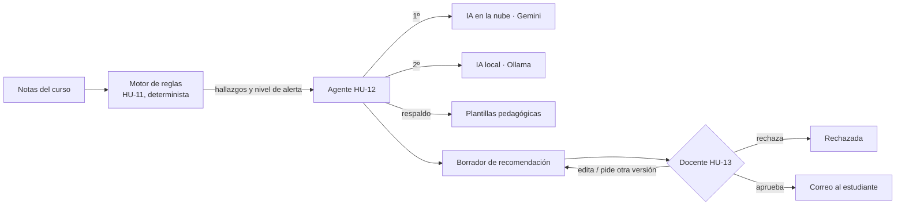
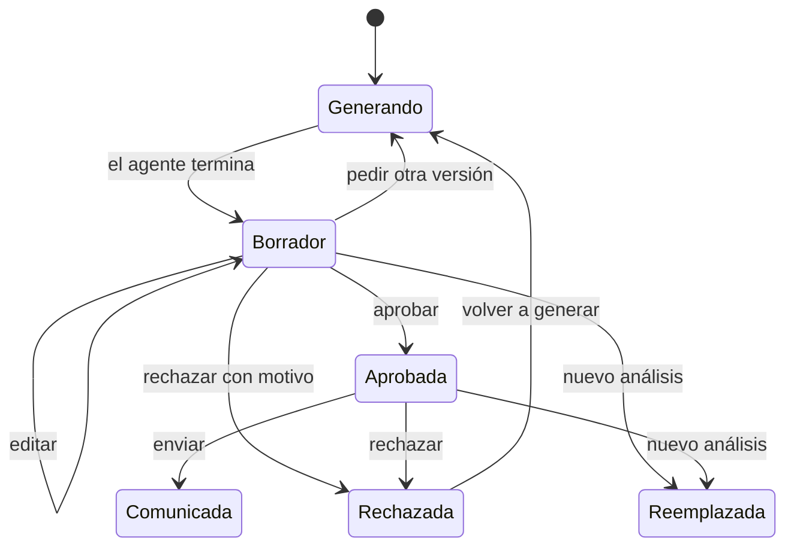
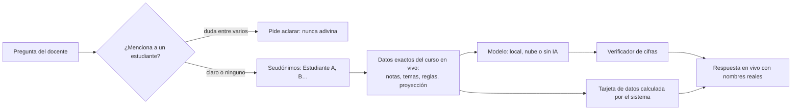

# Agente académico (Sprint 3: HU-11 a HU-14)

El servicio `seguimiento` (base `EduMonitor_Seguimiento`) detecta estudiantes con dificultades, redacta una recomendación para cada uno, deja que el docente la revise y la comunique, y genera reportes. No guarda cursos, estudiantes ni notas: los consulta a Materias, Estudiantes y Evaluaciones con el JWT del docente y guarda una **fotografía** de lo que analizó, para poder explicar después con qué datos se hizo cada recomendación.

## Principio de diseño: las reglas deciden, la IA solo redacta



* **Quién está en riesgo y por qué** lo decide el motor de reglas (`Reglas/MotorReglas.cs`), con código determinista y umbrales en `appsettings.json` (sección `Reglas`). La misma entrada da siempre el mismo resultado y cada alerta explica su causa con números. Una IA puede equivocarse; una regla no se inventa datos.
* **Cómo se redacta** la recomendación lo hace el agente. Si falla un proveedor pasa al siguiente y, al final, a las plantillas, así que **el sistema nunca se queda sin recomendaciones**, con o sin internet.
* **Qué se comunica** lo decide siempre el docente. El agente no escribe al estudiante por su cuenta.

## HU-11: reglas de detección

| Código | Cuándo se activa | Nivel |
|---|---|---|
| `RENDIMIENTO_BAJO` | Resultado actual menor que la nota mínima | Medio; Alto si está 2 puntos o más por debajo |
| `NOTA_CRITICA` | Notas menores que 5 | Medio (1 nota), Alto (2 o más) |
| `TENDENCIA_DESCENDENTE` | Con 4 o más notas, el promedio de las 2 últimas es 1,5 o más puntos menor que el de las anteriores | Medio; Alto si la caída es de 3 y queda bajo el mínimo |
| `TIPO_DEBIL` | Promedio de un tipo (tareas, APE, exámenes) más de 1 punto bajo el mínimo, con 2 o más notas | Bajo |
| `RIESGO_DE_REPROBAR` | Proyección: promedio que necesita en lo pendiente para llegar a la nota mínima | Medio si pasa de 8; Alto si pasa de 9 o si ni con 10 en todo lo pendiente llegaría |
| `ACTIVIDAD_DIFICIL` (curso) | Con la mitad o más del curso calificado, el promedio de la actividad está bajo el mínimo | Medio; Alto si está 1,5 o más por debajo |
| `CURSO_EN_RIESGO` (curso) | 40 % o más de los estudiantes con resultado están bajo el mínimo | Medio; Alto desde 60 % |

El nivel de un estudiante es el más alto de sus alertas. La proyección usa las ponderaciones del curso y supone que lo pendiente de un tipo sale igual; como el resultado es lineal en ese promedio, se despeja sin iterar. Una actividad sin nota es pendiente, nunca un cero.

## HU-12: el agente y sus proveedores

Un solo conector (`Agente/Proveedores.cs`) habla el protocolo *Chat Completions* de OpenAI, que entienden tanto Ollama como Gemini. Cambiar de proveedor es cambiar URL, modelo y clave.

| Proveedor | Cuándo conviene | Configuración por defecto |
|---|---|---|
| **Local (Ollama)** | Sin internet y sin que ningún dato salga del equipo | `http://host.docker.internal:11434/v1`, modelo `qwen2.5:3b` (cabe en una tarjeta de 4 GB) |
| **Nube (Google Gemini)** | Mejor redacción; clave gratuita | endpoint de compatibilidad OpenAI de Gemini, modelo `gemini-3.5-flash-lite` |
| **Plantillas** | Respaldo siempre disponible | sin configuración |

El orden se define en `Agente:Orden` (por defecto `["nube","local"]`: Gemini primero por su calidad y Ollama de respaldo; `["plantilla"]` desactiva la IA). Sin clave de Gemini, sin internet o con el límite gratuito agotado se usa la local de forma automática: la conexión a la nube se corta a los 5 s y, tras una caída, se salta durante 60 s para no esperar en cada pregunta. Con la nube primero, los datos del curso (con seudónimos, nunca con nombres) viajan a Google; si eso no es aceptable, usa `["local","nube"]`. Si un proveedor falla dos veces seguidas durante un análisis se deja de intentar con él en ese análisis, para no esperar su tiempo de espera con cada estudiante. La respuesta del modelo se valida (JSON, campos obligatorios, límites de longitud, sin enlaces ni correos); si no es válida se descarta y se usa el siguiente.

**Privacidad.** Al modelo solo se le envía el contexto académico anónimo (materia, notas con el nombre de la actividad, promedios y hallazgos). No lleva nombre, cédula, correo ni identificador. El saludo y la firma los agrega el sistema.

El panel «Alertas» del asistente (antes la pestaña «Alertas y recomendaciones») muestra a los estudiantes en riesgo, abre la revisión de cada recomendación (editar, aprobar, enviar) y el reporte del curso; el menú «Estado de la IA» de la barra lateral muestra qué motores están disponibles en ese momento. Cada recomendación guarda su origen (`Plantilla`, `Local` o `Nube`) y el modelo, y la pantalla de revisión lo indica.

### Preparar la IA (opcional)

```powershell
# IA local con Ollama instalado en Windows (usa la tarjeta gráfica)
.\scripts\Preparar-IA.ps1 -Modo Ollama
# IA local sin instalar nada en Windows (Ollama en Docker, solo CPU)
.\scripts\Preparar-IA.ps1 -Modo Docker
# IA en la nube: pide la clave gratuita de https://aistudio.google.com/apikey
.\scripts\Preparar-IA.ps1 -Modo Nube
```

La clave se guarda en `.local/agente.env`, que está fuera de Git. Sin nada de esto todo funciona con las plantillas.

## HU-13: revisión, aprobación y comunicación



* Solo el docente del curso decide (el administrador consulta). Un curso ajeno responde 404 y un período finalizado vuelve el seguimiento de solo lectura (409).
* Cada transición valida el estado actual y queda en la bitácora (`Eventos`): quién, qué y cuándo.
* Una recomendación se comunica **una sola vez**. Si el envío falla queda `Aprobada` y se puede reintentar.
* **Correo.** Con `Smtp:Host` y `Smtp:Remitente` configurados se envía de verdad. Sin ellos queda registrado como `Simulado`: se guarda el mensaje completo, pero no sale del sistema. La pantalla lo indica siempre.

Para SMTP real defina por variables de entorno del servicio `seguimiento`: `Smtp__Host`, `Smtp__Puerto`, `Smtp__Usuario`, `Smtp__Clave`, `Smtp__Remitente`, `Smtp__UsarSsl`.

## HU-14: reportes

`GET /api/seguimiento/cursos/{id}/reporte` entrega el panorama del último análisis (conteo por nivel, estado de las recomendaciones, alertas del curso y estudiantes en alerta con su recomendación y comunicación). En la interfaz se imprime o se guarda como PDF desde el navegador, y `reporte.csv` se abre en Excel (UTF-8 con BOM, separador `;`).

## Por qué es asíncrono

Redactar con un modelo tarda decenas de segundos por estudiante y el gateway corta las peticiones a los 10 s. `POST /analisis` toma la fotografía de las notas con el JWT del docente, ejecuta las reglas, guarda todo y responde `202`; un servicio en segundo plano redacta las recomendaciones una a una y la interfaz consulta el avance. Si el servicio se reinicia a mitad de un análisis, al arrancar retoma lo que quedó `Generando`.

## Asistente académico (chat del docente y rutas de mejora)

Pestaña **Asistente** dentro de cada curso. El docente conversa con el agente como en un chat: elige una pregunta sugerida o escribe lo que quiera, y puede nombrar a un estudiante por su **nombre**. Mantiene el principio de diseño del agente: **el sistema calcula, la IA explica**.



- **Preguntas sugeridas** (agrupadas): ruta de mejora de un estudiante, rutas de todos los estudiantes en riesgo, atención urgente, cómo apoyar a un estudiante, estado del curso, actividad que salió peor, temas a reforzar, dificultad de las evaluaciones y tutoría de refuerzo. Cada una arma sus datos exactos con código y el modelo solo los redacta. **Sin IA siguen funcionando**: muestran la tarjeta de datos y avisan que no hay modelo para el texto.
- **Preguntas libres**: cualquier pregunta. Si trata de los datos del curso se responde con ellos; si es pedagogía general lleva la etiqueta «Respuesta general, sin datos del curso»; si no es de docencia, el asistente dice que solo ayuda con temas académicos. El modelo empieza su respuesta con `[CURSO]` o `[GENERAL]` y el sistema la usa para la etiqueta.
- **Respuesta en vivo**: el servidor manda eventos `text/event-stream` (`inicio`, `tarjeta`, `texto`, `ruta`, `aclaracion`, `fin`, `error`) y un latido cada 4 s para que el gateway y Nginx no corten la conexión mientras el modelo arranca (`X-Accel-Buffering: no`). Al abrir el chat se calienta el modelo local.
- **Contexto acotado**: resumen del curso, datos de los estudiantes mencionados y los últimos 6 mensajes. El modelo del chat es `edumonitor-asistente`, una variante de `qwen2.5:3b` con ventana de 8192 tokens (Ollama usa 4096 por defecto); `Preparar-IA.ps1` la crea y, si no existe, se usa el modelo normal.

### Buscar al estudiante sin confusiones

`Seudonimos.Buscar` ignora tildes y mayúsculas. **Dos o más palabras** del nombre identifican al estudiante («Elena Viteri»). Si dos estudiantes coinciden igual de bien («Mismo Apellido»), o solo coincide una palabra suelta con mayúscula inicial («Viteri»), **no se adivina**: el chat muestra la lista, con el **correo** de cada uno para distinguir a los homónimos, y el docente elige uno o varios, o sigue sin identificar a nadie. Una palabra común en minúscula («paz») nunca se toma por un apellido.

La búsqueda es **solo por nombre**: el asistente no lee ni muestra cédulas, y la lista de estudiantes del docente sigue sin incluirlas (regla del Sprint 1).

### Seudónimos: nada personal sale hacia el modelo

Hacia el modelo viajan «Estudiante A», «Estudiante B»… y las notas; nunca nombres ni cédulas. El servidor traduce al mostrar la respuesta (también cuando llega partida en fragmentos). Lo que el docente escribe se enmascara antes de enviarlo: los nombres del curso pasan a seudónimo o a «[nombre omitido]» y cualquier número de 10 dígitos (parece una cédula) se reemplaza por «[número omitido]». El **historial guarda solo seudónimos**; los nombres reales se resuelven al mostrarlo, con la lista actual del curso. Cada conversación tiene su propia tabla de seudónimos, así «Estudiante A» es siempre la misma persona.

### Verificador de cifras

Antes de mostrar una respuesta se comprueba que cada nota, promedio o porcentaje que cita exista en los datos entregados. Si no, aparece un aviso («la cifra X no aparece en los datos del curso: confía en la tarjeta»). También avisa si el modelo nombra a un seudónimo que no es de la conversación. Las rutas, que llegan al estudiante, son más estrictas: si el modelo inventa una cifra se descarta su redacción y queda la plantilla.

### Ruta de mejora

Para cada estudiante el sistema calcula, con números exactos y sin IA:

| Dato | Cómo se obtiene |
|---|---|
| Estado | `Aprobado`, `Asegurado`, `Alcanzable`, `Exigente` (promedio requerido > 8), `MuyExigente` (> 9), `Imposible` (aun con 10 no llega), `SinPendientes`, `SinNotas` |
| Promedio requerido y máximo posible | La proyección lineal del motor de reglas |
| Temas débiles | El promedio del estudiante en las actividades de un tema queda por debajo de la nota mínima; se listan las actividades que lo muestran |
| Etapas | Una por actividad pendiente (máximo 4), ordenadas por fecha de entrega; la última agrupa el resto. Cada una trae su nota objetivo, el aporte de la actividad a la nota final y los **temas que evalúa**, con los que más le cuestan primero |

La IA solo redacta las acciones de estudio de cada etapa, un resumen, acciones para el docente y el mensaje al estudiante. Si el modelo no responde o responde algo inválido, las acciones salen de plantillas y la ruta sigue completa. Si ya no puede aprobar, la ruta se convierte en un **plan de recuperación**.

**Guardar como recomendación** (o «todas», para un lote) la pasa al flujo de revisión de HU-13 como borrador. Requiere un análisis del curso y no sobrescribe una recomendación aprobada o comunicada. Allí el docente la edita, la aprueba y la comunica: el correo incluye las etapas y su meta. **Descargar PDF** abre la ruta como documento aparte para guardarla como PDF desde el navegador.

### Historial temporal

Las conversaciones se guardan por curso y docente y **se borran solas a los 30 días de su último mensaje** (`Asistente:RetencionDias`): al abrir la lista y a diario desde un servicio de fondo. El docente puede borrar una conversación cuando quiera y otro docente nunca la ve. Las rutas guardadas como recomendación no se borran: ya son parte del seguimiento. Cada respuesta se puede valorar con 👍/👎.

### Límites

- Una respuesta a la vez por docente (HTTP 429): la IA local usa la tarjeta gráfica de la máquina.
- Preguntas de hasta 800 caracteres, hasta 52 estudiantes distintos por conversación y hasta 10 rutas por lote.
- Solo el docente del curso usa el asistente; el administrador no entra (403).
- `qwen2.5:3b` es rápido pero a veces comete deslices de redacción. Los números siempre vienen de las tarjetas. Un modelo más grande (p. ej. `qwen2.5:7b`) mejora la redacción: se cambia `Agente:Local:Modelo` y se vuelve a ejecutar `Preparar-IA.ps1 -Modelo qwen2.5:7b`.

## Temas de las actividades

Cada actividad se relaciona con uno o varios temas del curso (HU-06). Al crear una actividad a mano se exige al menos un tema si el curso ya tiene temas; al editarla sin enviar la lista de temas se conservan los que tenía. En cursos vinculados a Moodle los temas los decide la sincronización. El seguimiento los usa para decir **qué reforzar**: promedio por tema del curso y de cada estudiante.
