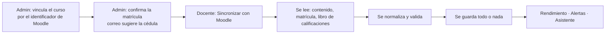

# Moodle como fuente de los datos académicos

EduMonitor no reemplaza a Moodle: **lo lee**. El docente carga y califica en Moodle; EduMonitor calcula el rendimiento, detecta alertas y recomienda. No modifica notas en Moodle ni recibe notas escritas a mano.

## Fuente de los datos (`Moodle` o `Manual`)

Un ajuste global (administrador → Cursos, «Fuente de los datos académicos»; `GET/PUT /api/moodle/fuente`) decide de dónde salen las unidades, los temas, las actividades y las notas.

| Fuente | Qué pasa |
|---|---|
| **Moodle** (por defecto) | Los datos se leen de Moodle. **Nadie los edita a mano**, ni siquiera un curso que aún no se vinculó (`409` con el mensaje de qué hacer). Contenido, Actividades y Calificaciones son de solo lectura. |
| **Manual** | El docente registra y edita todo en EduMonitor. Es para desarrollo, pruebas y cursos sin Moodle. Un curso vinculado a Moodle sigue siendo de solo lectura. |

El ajuste se guarda en la base (tabla `Ajuste` de Evaluaciones), así que se cambia sin reiniciar. Las pruebas de integración que editan a mano lo pasan a `Manual` mientras corren y lo restauran al terminar.

## Flujo

1. **Vincular.** El administrador relaciona el curso de EduMonitor con el de Moodle por su identificador (`idnumber`). **Ese identificador lo genera el sistema y nadie lo elige ni lo cambia**: materia + año y meses del período + paralelo (por ejemplo `SOF-101-2026AD-A`). Es único: si dos cursos dieran el mismo, el segundo en crearse lleva un sufijo (`-2`) y el primero conserva el suyo, así un código ya entregado nunca cambia. En Moodle el curso se crea con ese valor en «Número de ID del curso»; la base además exige que un código, un curso de Moodle y un curso de EduMonitor se vinculen una sola vez. La API rechaza (400) cualquier otro valor.
2. **Matrícula.** Los estudiantes se enlazan por su id estable de Moodle. Si ya existe un estudiante con el mismo **correo**, su cédula viene sugerida y solo se confirma.
3. **Sincronizar.** El docente asignado pulsa el botón. Se hacen tres lecturas con una cuenta de servicio de permisos mínimos: contenido del curso, matrícula y libro de calificaciones. Todo ocurre en una transacción: si algo falla, no queda nada a medias. Moodle manda también al borrar: lo que ya no existe allá (actividades, temas o unidades) se retira de EduMonitor con sus notas y la sincronización lo avisa («retirados»). Como freno, si Moodle no devuelve nada de contenido se rechaza la sincronización y no se borra nada.

## Cómo se lee un curso

El lector no exige un formato especial: entiende un curso razonable de Moodle.

- **Unidades.** Cada sección que tiene actividades calificadas. Si su resumen sigue el formato `<h4>Temática N: …</h4>
…
` cada temática es un tema; si no, la sección entera es un solo tema.
- **Tipo de actividad.** Un cuestionario o un nombre como «Examen», «Prueba» o «Parcial» es **Examen**; «APE», «Práctica», «Laboratorio» o «Proyecto» es **APE**; lo demás es **Tarea**. Los patrones se ajustan en la configuración (`Moodle:Tipos:Examen` y `Moodle:Tipos:Ape`). El código antiguo del aula de ejemplo (`…-T1`, `…-APE`, `…-EX`) sigue valiendo.
- **Temas de una actividad.** Un examen cubre toda la unidad; una tarea con código `…-T2` cubre la temática 2; si el nombre de la actividad menciona un tema, ese; sin otra pista, toda la unidad. Así ninguna actividad queda sin tema.
- **Fechas de entrega.** Se toman de Moodle (`duedate`, o `timeclose` en cuestionarios) cuando la actividad las tiene, en hora de Ecuador. Sin fecha en Moodle queda «sin fecha».
- **Escala.** Cualquier escala de Moodle (0-100, 0-20…) se normaliza a 0-10.
- **Ponderación.** Si el libro de calificaciones tiene una categoría por tipo (Tareas, APE, Exámenes), esa es la ponderación del curso. Si no, se conserva la de EduMonitor y se avisa.
- **Identificador del estudiante.** Su `idnumber`; si no tiene, su usuario de Moodle.

### Datos que Moodle no entrega
Una **nota 0 es 0**. Una celda vacía, una nota que Moodle todavía debe recalcular o un libro que no llegó quedan como **«no disponible»** y nunca se convierten en 0. No tumban el curso: aparecen como **avisos** en el resultado de la sincronización. Un total de Moodle que difiere del que calcula EduMonitor también solo avisa.

Lo único que se rechaza es lo ambiguo: estudiantes con el mismo identificador, una actividad con datos contradictorios, un curso sin matrícula o sin actividades calificadas, o una matrícula de Moodle que no coincide con las correspondencias locales.

## Conflictos
Una nota vacía en Moodle **no borra** la nota local: se conserva y aparece como conflicto. Si Moodle omite algo que antes estaba vinculado, no se aplica ningún cambio.

## Limitaciones conocidas
- La sincronización es **manual** (un botón por curso).
- Un estudiante **nuevo** necesita una cédula la primera vez; si ya existe con el mismo correo se sugiere sola.
- No distingue «sin entrega» de «sin calificar»: ambas son nota pendiente.
- Moodle debe tener los datos cargados. Las fechas de entrega solo sirven para ordenar la ruta de mejora; no hay alertas de «entregas vencidas», porque en EduMonitor nadie entrega nada y Moodle no distingue «sin entrega» de «sin calificar». La finalización de actividades no se lee.
- No se escriben notas en Moodle.

## Puesta en marcha en este equipo
Ver el README (`Puesta en marcha de Moodle y de la IA`) y `scripts/moodle/README.md`.

## Cursos nuevos en Moodle: permisos de la cuenta de lectura

EduMonitor lee Moodle con una cuenta técnica de solo lectura (`edumonitor_lectura`, rol «Lectura del aula para EduMonitor»). El script
`scripts/moodle/preparar-lectura.php` le da esas capacidades **solo en el curso de Física**. Un curso nuevo se encuentra por su Número de ID,
pero al leer su contenido Moodle responde que no hay permiso y EduMonitor muestra «Moodle no dejó leer este curso (core_course_get_contents…)».

Se arregla una sola vez, sin tocar código, en Moodle: **Administración del sitio → Usuarios → Permisos → Definir roles → «Lectura del aula para
EduMonitor» → Editar** y permitir (todas son de solo lectura) `moodle/course:view`, `moodle/course:viewparticipants`, `moodle/user:viewdetails`,
`moodle/site:viewuseridentity`, `moodle/user:viewalldetails`, `moodle/grade:viewall`, `gradereport/user:view`, `mod/assign:view` y `mod/quiz:view`.
La cuenta ya tiene el rol asignado en todo el sitio, así que desde ese momento lee cualquier curso.
